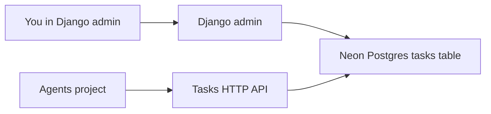
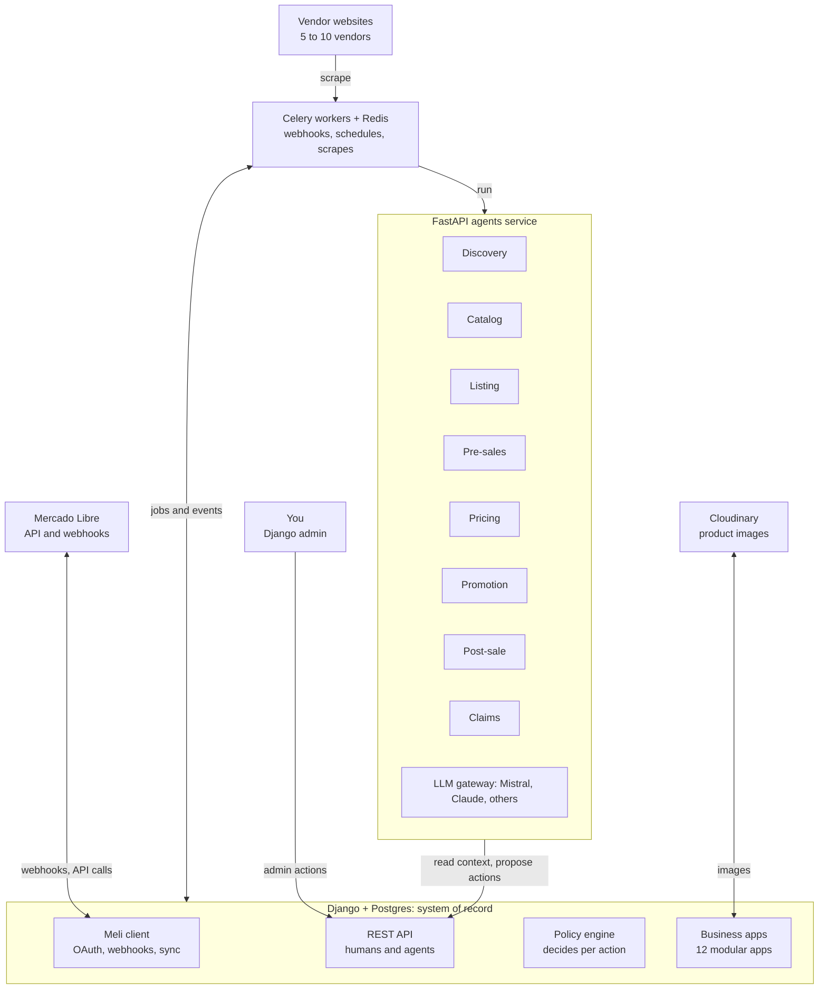
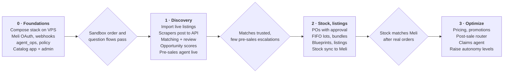

# Scent — Agent-First Platform Spec

_Last updated: Oct 27, 2026_

## Current milestone

Django is the system of record. This milestone is one app, `tasks`, on Neon Postgres. Humans and agents share that table. Agents live in a separate project and never touch the database.

**What this milestone is**

- Humans work the queue in Django admin.
- Agents create and update tasks only through this app's HTTP API (`/api/tasks`), authenticated with a bearer token.
- The app runs as a Render Docker web service. Render sets `PORT`, and gunicorn binds to it.
- Postgres is Neon. Django reads `DATABASE_URL` from the environment (locally, from `.env`). Render does not store the database on its disk.

**What is deferred**

The twelve business apps, an in-repo FastAPI agents service, Celery, and the VPS Compose stack stay in [Later: Mercado Libre platform](#later-mercado-libre-platform). Do not build them in this milestone.

### Task

Table name `tasks`. Django adds a numeric `id` primary key. The other columns match the original table. Priority, effort, status, and assignee are free text.

| Column | Required | Notes |
| --- | --- | --- |
| `timestamp` | yes | Form submission time. Defaults to now; callers may set it. |
| `email_address` | yes | Submitter, human or agent. |
| `task_title` | yes | |
| `priority` | no | e.g. `1-Low: can be pushed to next month`, `3-High: Do this week` |
| `description` | no | |
| `task_deepdive_link` | no | Google Docs or Drive URL |
| `ticket_id` | no | Drive file id. Filled from the deepdive link when empty. |
| `effort` | no | |
| `status` | no | e.g. `Done` |
| `assignee` | no | |

### API

Mounted at `/api/`. Every route requires `Authorization: Bearer <TASKS_API_TOKEN>`. OpenAPI is at `/api/docs` for the agents project.

- `GET /api/tasks` — optional filters `status`, `assignee`, `priority`
- `POST /api/tasks`
- `GET /api/tasks/{id}`
- `PATCH /api/tasks/{id}`

### Deploy

Render Docker web service, defined in `render.yaml`. Connect the GitHub repo and apply the blueprint. Paste `DATABASE_URL` (the Neon connection string) and `CSRF_TRUSTED_ORIGINS` (the service origin, `https://scent-tasks.onrender.com`). Render generates `SECRET_KEY` and `TASKS_API_TOKEN`. Do not set `DEBUG` or `DJANGO_SUPERUSER_*`. The admin user already in Neon is the login. A free instance spins down when idle. `GET /health/` returns `ok` and does not use the database; ping it from outside every 10 minutes to keep the instance awake. Tasks stay in Neon.

## Later: Mercado Libre platform

_The sections below are the previous design. They are not the current build._

### Overview

Scent is a perfume reseller on Mercado Libre (MLA), run by one person, built so that agents can operate it end to end. Django is the system of record that humans and agents both act through. Agents run in a FastAPI service and never touch the database directly. The first version targets 100–200 SKUs, 5–10 vendors and one Meli account. The design keeps a clean path to a multi-tenant SaaS, with Scent as the first tenant.

**Goals for v1**

- Find arbitrage opportunities by matching Meli catalogs against vendor catalogs and the master catalog, scored by margin over a time window (e.g. 15 days).
- Track purchases and stock at the lot level (FIFO cost), with bundles that consume component stock.
- Publish and sync Meli listings from blueprints, including bundles and catalog placeholders.
- Answer pre-sales questions fully automatically from day one; run everything else in suggest mode until trust is earned.

**Design principles**

1. **Agents are API users, not scripts.** Each agent has its own identity and scoped token, and acts through the same Django API a human would. Every action is validated and audited in one place.
2. **Agents propose, policy decides.** Every agent action passes through an autonomy policy: *suggest* (human approves), *auto within limits*, or *full auto*. Raising autonomy is a config change, not a rewrite.
3. **One monolith, one agents service.** Django modular apps plus a single FastAPI service with one module per agent. Split only when a real need appears.
4. **Ledgers over counters.** Stock, prices and agent decisions are append-only records; current state is derived. This makes margins, audits and debugging reliable.
5. **Tenant-aware from day one.** Every business table carries an `organization` foreign key, even while there is only one organization.
6. **LLM-agnostic.** Agents call models through one gateway, so Mistral, Claude or others can be swapped per task and costs are tracked per run.

### Architecture

Events enter through Meli webhooks, schedules or the admin, and Celery turns each into a job. Jobs run Django logic directly (stock sync, token refresh) or call an agent. Agents read context and submit proposed actions through the REST API. The policy engine applies, queues or rejects each one, and only Django's Meli client talks to Mercado Libre.

### Tech stack and hosting

Run everything on your VPS with Docker Compose. Meli webhooks need an always-on endpoint that answers fast, which rules out anything that sleeps. Render's paid instances don't sleep, but at this scale a VPS is cheaper and simpler.

| Layer | Choice | Why |
| --- | --- | --- |
| Backend / system of record | Django 5 + Postgres 16 | You know it; admin doubles as the ops console |
| API | django-ninja | Same Pydantic schemas as the agents; auto OpenAPI doubles as agent tool specs |
| Background jobs | Celery + Redis, Celery Beat for schedules | Webhook fan-out, scrapes, stock sync, repricing runs |
| Agents service | FastAPI + Pydantic, one module per agent | Async I/O for LLM, scraping and API calls |
| LLM gateway | LiteLLM (library mode) or pydantic-ai | One interface for Mistral, Claude and others; cost per call |
| Scraping | httpx + selectolax; Playwright only where JS is required | Reuse your existing vendor automations as scrapers |
| Media | Cloudinary (free tier) | Background removal and transforms via URL |
| Reverse proxy / TLS | Caddy | Automatic HTTPS for the webhook URL |
| Deploy | Docker Compose; optionally Coolify or Dokploy on the VPS | Git-push deploys without managing a platform |
| Observability | Sentry free tier + structured logs; `agent_ops` tables for agent traces | Errors plus a full record of every agent decision |
| Backups | Nightly `pg_dump` to object storage | Single VPS means backups are non-negotiable |

Compose services: `caddy`, `django` (gunicorn), `worker` (celery), `beat`, `agents` (uvicorn), `postgres`, `redis`. Seven containers, one host, one `docker compose up`.

### SaaS readiness

Use a shared database with a shared schema and an `organization_id` on every business table. It is the cheapest model to build now and scales to hundreds of tenants. Schema-per-tenant (django-tenants) adds migration and tooling overhead you don't need yet.

What to do in v1, even with one tenant:

- `Organization` and `Membership` models; every user and agent identity belongs to an organization.
- An abstract `TenantModel` base with `organization` FK and a default manager that filters by the current organization (set by middleware from the request's token).
- `MeliAccount` belongs to an organization, not to the system, so a tenant can connect its own seller account later.
- Unique constraints include `organization` (e.g. `unique(organization, sku)`).
- Settings that differ per business (margin floors, autonomy levels, fee assumptions, LLM budget) live in database rows per organization, not in `settings.py`.

What to defer: billing, self-serve signup, per-tenant LLM keys, row-level security in Postgres. Add these when the second tenant is real.

### Django apps and data model

Twelve apps, one per bounded context. All business models inherit `TenantModel` (organization FK, `created_at`, `updated_at`). Money is stored as `Decimal` in ARS with an `fx_rate_id` wherever the value comes from an external snapshot.

#### accounts

- **Organization**: name, slug, settings (JSON: margin floor, fee assumptions, LLM monthly budget).
- **User** (custom from day one) + **Membership**: user, organization, role (owner, operator, viewer).
- **AgentIdentity**: organization, name (`presales`, `pricing`…), scopes (list of allowed API actions), active, token hash.

#### catalog

- **Brand**: name, normalized_name.
- **MasterProduct**: sku (unique per org), title, brand, line_name, concentration (EDP/EDT/Parfum/Extrait/Cologne), size_ml, gender, ean (nullable), is_tester, is_set, description, general_characteristics (JSON), meli_catalog_product_id (nullable), status (draft, in_review, approved, archived).
- **ProductMedia**: product, cloudinary_public_id, url, role (main, gallery), is_white_background, source (meli, vendor, own), position.
- **Bundle**: sku, title, description, status. **BundleComponent**: bundle, product, quantity.

#### discovery

- **Vendor**: name, website, scraper_key (which scraper module handles it), active, notes.
- **FxRate**: date, source (e.g. BNA oficial, MEP), ars_per_usd.
- **ScrapeJob**: kind (vendor_catalog, meli_item, meli_product), target_url, requested_by (user or agent), status, started_at, finished_at, error, stats (JSON).
- **VendorOffer**: vendor, scrape_job, vendor_sku, raw_title, raw_payload (JSON), price_ars, in_stock, fx_rate, captured_at. Append-only: each scrape adds rows.
- **MeliSnapshot**: meli_item_id or meli_product_id, scrape_job, title, price_ars, sold_quantity, available_quantity, seller_count, listing_type, raw_payload (JSON), fx_rate, captured_at. Append-only.
- **ProductMatch**: master_product, source_type (vendor_offer, meli_snapshot), source_key, method (ean, rules, fuzzy, llm), confidence, status (proposed, confirmed, rejected), decided_by.
- **Opportunity**: master_product, best_vendor_offer, reference_meli_snapshot, window_days, est_units, unit_margin_ars, total_margin_ars, score, status (new, approved, purchased, dismissed), computed_at.

#### purchasing

- **PurchaseOrder**: vendor, status (draft, pending_approval, approved, ordered, received, cancelled), proposed_by, approved_by, approved_at, notes, total_ars.
- **PurchaseOrderLine**: po, product, quantity, unit_cost_ars, vendor_offer (the offer it came from).

#### inventory

- **StockLot**: product, po_line, vendor, received_at, quantity_received, unit_cost_ars. One lot per received PO line.
- **StockMovement**: product, lot, quantity (+/−), kind (receipt, sale, bundle_sale, adjustment, return), reference (order line, PO line, manual), created_by, created_at. Append-only; on-hand stock = sum of movements.
- **StockReservation** (optional in v1): product, order, quantity, expires_at. Prevents overselling between paid and shipped.

#### listings

- **ListingBlueprint**: product or bundle (one of), title, description, listing_type (gold_special, gold_pro), category_id, attributes (JSON), media (ordered list), price_strategy (JSON), shipping_mode, status.
- **MeliListing**: blueprint, meli_item_id, kind (regular, catalog, placeholder), meli_catalog_product_id, status (active, paused, closed, under_review), price_ars, available_quantity, last_synced_at, sync_error.
- **ListingSyncEvent**: listing, direction (push, pull), payload (JSON), result, created_at.

#### pricing

- **PricingRule**: scope (product, bundle, all), min_margin_pct, min_margin_ars, max_step_pct, strategy (match_buybox, undercut_by, fixed), active.
- **PriceChange**: listing, old_price, new_price, reason, proposed_by, applied_at, agent_action.
- **CompetitorSnapshot**: listing, meli_product_id, buybox_price, buybox_winner_is_us, competitor_count, captured_at.
- **Promotion**: listing, meli_promotion_id, type, discount_pct, start, end, status, decided_by.

#### orders

- **Order**: meli_order_id, buyer_nickname, status, total_ars, paid_at, shipping_id, shipping_status, raw_payload (JSON).
- **OrderLine**: order, listing, product or bundle, quantity, unit_price_ars, fees (JSON: commission, shipping cost, payment fee), cogs_ars (filled from FIFO lots at sale time).

#### conversations

- **PreSaleQuestion**: meli_question_id, listing, text, asked_at, status (new, answered, escalated), answer_text, answered_by (agent or user), answered_at, agent_action.
- **PostSaleMessage**: order, meli_message_id, direction, text, created_at, category, priority, routed_to (agent, human), status.
- **AnswerExample**: kind (presale, postsale), question_text, answer_text, source (human_edit, approved_agent), embedding (pgvector, optional). Fuel for few-shot retrieval.

#### claims

- **Claim**: meli_claim_id, order, reason (delay, wrong_item, damaged, not_received, other), stage, status, due_at, raw_payload (JSON).
- **ClaimAction**: claim, kind (message, evidence, refund, return_label, escalate), payload (JSON), proposed_by, approved_by, executed_at.

#### integrations.meli

- **MeliAccount**: organization, seller_id, nickname, access_token (encrypted), refresh_token (encrypted), expires_at.
- **WebhookEvent**: topic, resource, raw_payload, received_at, processed_at, status, attempts. Every notification is stored before it is processed.

#### agent_ops

See *Agent framework* below for AgentRun, AgentAction, ApprovalRequest, AutonomyPolicy and PromptVersion.

### Agent framework

Every agent decision becomes an `AgentAction` that Django either applies, queues for approval, or rejects according to an `AutonomyPolicy`. This is the mechanism that lets the business move from supervised to autonomous one action type at a time.

#### agent_ops models

- **AgentRun**: agent, trigger (webhook, schedule, manual), input_ref, status, started_at, finished_at, llm_model, tokens_in, tokens_out, cost_usd, prompt_version, trace (JSON: tool calls and intermediate steps).
- **AgentAction**: run, action_type (e.g. `presale.answer`, `price.change`, `listing.create`, `claim.message`), target (generic FK), payload (JSON), confidence, rationale, status (proposed, auto_applied, pending_approval, approved, rejected, failed), decided_by, applied_at.
- **AutonomyPolicy**: organization, action_type, mode (suggest, auto_with_limits, full_auto), limits (JSON, e.g. `{"max_price_change_pct": 5, "min_confidence": 0.8}`).
- **ApprovalRequest**: action, assigned_to, due_at, human_edit (JSON, what the human changed before approving).
- **PromptVersion**: agent, name, template, model, created_at, active. Runs record the version they used.

#### Request lifecycle

1. A trigger (Meli webhook, Celery Beat schedule, or a button in the admin) enqueues a job naming an agent and an input.
2. The worker calls the agents service: `POST /agents/{name}/run` with the input reference.
3. The agent reads context from the Django API with its own token, calls the LLM gateway, and returns one or more proposed actions.
4. Django's policy engine checks each action against its `AutonomyPolicy`: apply it, create an `ApprovalRequest`, or reject it (e.g. below the margin floor).
5. Applied actions call out to Meli through the Meli client; results are written back to the action.

Agents never hold Meli tokens and never write directly to Postgres.

#### LLM gateway and budget

- One `llm.complete(task, messages, schema)` interface in the agents service, backed by LiteLLM. Each task names a default model; switch per task in config.
- Defaults: Mistral Small for classification and pre-sales answers (cheap, fast, fits the free tier), a stronger model (Mistral Large or Claude) for catalog enrichment and claims, where quality matters more than cost.
- Structured outputs everywhere: agents return Pydantic-validated JSON, never free text that Django has to parse.
- Every call logs tokens and cost to its `AgentRun`. A daily job sums spend against the organization's monthly budget (USD 10 to start) and downgrades or pauses non-critical agents near the limit. Pre-sales stays on.

#### Learning from corrections

- When a human approves an action after editing it, the edited version is stored as an `AnswerExample` (or the equivalent for other action types).
- Agents retrieve the closest examples for few-shot prompting: start with keyword and product matching in Postgres, add pgvector embeddings when the example set passes a few hundred.
- Approval rate and edit distance per action type, tracked from `ApprovalRequest`, are the evidence for raising an action's autonomy mode.

### Agent specifications

Eight agents, one module each in the FastAPI service. Only the pre-sales agent starts in full auto; the rest start in suggest mode.

| Agent | Trigger | Reads | Proposes | Starting autonomy |
| --- | --- | --- | --- | --- |
| Discovery | Scrape job finished; daily schedule | VendorOffer, MeliSnapshot, catalog | ProductMatch, MasterProduct drafts, Opportunity | Suggest (you confirm matches and products) |
| Catalog enrichment | New or edited MasterProduct | Meli snapshot, vendor data, media | Description, characteristics JSON, white-background media | Suggest |
| Listing | Blueprint approved; stock change | Blueprint, stock, Meli category rules | `listing.create`, `listing.update`, `listing.pause` | Suggest; stock sync is plain code, full auto |
| Pre-sales | `questions` webhook | Listing, product, stock, shipping, AnswerExample | `presale.answer` or `presale.escalate` | Full auto with guardrails |
| Pricing | Every few hours; competitor change | CompetitorSnapshot, cost (FIFO), fees, PricingRule | `price.change` | Auto within limits once rules are set; suggest at first |
| Promotion | Meli campaign invitations; schedule | Promotions, margins | `promotion.join`, `promotion.decline` | Suggest |
| Post-sale router | `messages` webhook | Order, shipping status, message history | Category + route; draft reply | Classification auto; replies suggest |
| Claims | `claims` webhook | Claim, order, shipping, messages | `claim.message`, `claim.evidence`; refunds always human | Suggest |

#### Pre-sales guardrails (full auto from day one)

- Answer only from retrieved facts: product data, stock, shipping mode, and approved examples. If a needed fact is missing, escalate instead of guessing.
- Never promise delivery dates beyond what Meli shows, never confirm authenticity claims beyond an approved standard phrase, never include contact details or links (Meli rules forbid them).
- A deterministic post-check scans each answer for phone numbers, emails, URLs, prices that differ from the listing, and banned words before posting.
- Escalate when confidence is below the threshold, when the question mentions a complaint, or when the buyer asks about something not in the catalog. Escalations notify you (Telegram or email).
- Target: answer within 5 minutes of the webhook.

#### Post-sale categories (v1)

`shipping_delay`, `wrong_item`, `damaged`, `authenticity`, `return_request`, `invoice_request`, `other`. Delays get an automatic status-based reply draft from shipping data; wrong item always routes to you and pre-fills the claims workflow.

### Key process flows

#### 1. Discovery

1. You add a vendor URL or a Meli listing/catalog URL in the admin; this creates a `ScrapeJob`.
2. The matching scraper (your existing automations, wrapped as scraper modules) runs and posts results to the API as `VendorOffer` or `MeliSnapshot` rows, each stamped with the day's `FxRate`.
3. The discovery agent matches each row to a `MasterProduct`: EAN first, then rules (brand + line + concentration + size_ml + tester/set flags), then fuzzy plus LLM verification. Unmatched Meli items become draft products.
4. Low-confidence matches and new drafts land in your review queue; you confirm, reject or merge.
5. The opportunity job computes scores for confirmed matches (formula below) and lists them ranked in the admin.

**Opportunity score**

For a window of `window_days` (default 15):

- `est_units` = sales velocity from the change in `sold_quantity` between Meli snapshots, scaled to the window. Meli shows sold quantities in ranges, so velocity needs at least two snapshots some days apart; treat early estimates as low confidence.
- `unit_margin` = Meli price − commission − shipping subsidy − payment fee − vendor price.
- `total_margin` = `est_units` × `unit_margin`. Rank by `total_margin`; filter by a minimum `unit_margin` percentage.

Fees come from Meli's listing-price endpoint where possible, so they reflect the real category and listing type, with a configurable fallback per organization.

#### 2. Purchase

1. From an approved opportunity (or manually), a draft `PurchaseOrder` is created with lines priced from the vendor offer. An agent may propose POs later.
2. Draft → `pending_approval` → you approve → `ordered`.
3. On arrival you mark lines received; each line creates a `StockLot` and a `receipt` `StockMovement`. Stock sync to Meli runs automatically.

#### 3. Listing creation

1. A confirmed `MasterProduct` (or `Bundle`) gets a `ListingBlueprint`, drafted by the listing agent from catalog data and approved by you.
2. Depending on kind: a regular listing from the blueprint; a catalog listing tied to `meli_catalog_product_id`; or a placeholder catalog listing with 0 stock to keep the catalog slot.
3. Media is pushed from Cloudinary URLs; the resulting `meli_item_id` is stored on `MeliListing`.

#### 4. Sale and stock sync

1. Meli sends an `orders_v2` notification; Django stores the `WebhookEvent` and fetches the order.
2. For each line: a product consumes FIFO lots; a bundle explodes into its `BundleComponent`s and consumes each component's lots (`bundle_sale` movements). COGS is written on the `OrderLine`.
3. Available stock is recomputed for every affected product and every bundle that contains it. Bundle availability = the minimum over components of floor(component stock ÷ component quantity).
4. A sync job pushes `available_quantity` to every affected `MeliListing`. This step is deterministic code, not an agent.

#### 5. Pre-sales question

1. `questions` webhook → stored → pre-sales agent run.
2. Agent retrieves facts and similar `AnswerExample`s, drafts an answer with a confidence score.
3. Post-check passes and confidence ≥ threshold → answer posted to Meli automatically. Otherwise → escalated to you with the draft pre-filled.
4. Any answer you edit is saved as a new example.

#### 6. Post-sale and claims

1. `messages` webhook → the router classifies and prioritizes, then either drafts a reply (delays, invoices) or routes to you (wrong item, damaged, authenticity).
2. `claims` webhook → the claims agent assembles the timeline (order, shipping events, messages) and proposes the next step before Meli's deadline. Refunds and returns always need your approval.

### Mercado Libre integration

All Meli access goes through one client in `integrations.meli`, owned by Django. Use the official API first and scrape only what it doesn't expose.

- **App and OAuth:** register a Meli app with the webhook URL (`https://<your-domain>/meli/webhooks/`). Store access and refresh tokens encrypted per `MeliAccount`; a Celery task refreshes them before expiry (access tokens last about 6 hours).
- **Webhooks:** subscribe to `orders_v2`, `questions`, `messages`, `claims`, `items`, `shipments` and promotion topics. The endpoint stores the raw `WebhookEvent` and returns 200 immediately; processing happens in Celery. Meli sends only a resource path, so the worker fetches the resource. Make processing idempotent: the same notification can arrive several times.
- **Reconciliation:** a scheduled job polls recent orders, questions and claims to catch missed notifications.
- **Rate limits and retries:** a shared limiter in the client, exponential backoff on 429 and 5xx, and every write logged as a `ListingSyncEvent` or on its `AgentAction`.
- **Endpoints used in v1:** items (create, update, pause, close), products (catalog data), questions and answers, orders, shipments, post-sale messages, claims, listing prices (fee calculation), seller promotions, and price-to-win or buy-box data for catalog listings.
- **Sandbox:** Meli's test users let you create listings and orders without touching your real account; use them for integration tests.

Verify endpoint names and topics against the current Meli developer docs during Phase 0; the API changes and some features are restricted by country or seller reputation.

### Phased roadmap

Phase 0 is pure plumbing, so every later agent plugs into the same policy engine and audit trail. The pre-sales agent ships in Phase 1 on your live listings. Since you already sell, Phase 1 starts by importing existing Meli listings into MeliListing and linking each to a master product, so the agent answers real questions from the first week. Pricing comes last because it needs reliable FIFO costs and real competitor snapshots before it can be trusted.

### Open questions and risks

**Open questions**

- [ ] Should margins include taxes (IIBB, IVA if you invoice) and packaging? They are excluded from the formula today.
- [ ] Which FX rate source to store: BNA oficial, MEP or blue? Vendor prices are in ARS, so FX is used for analytics, not costing.
- [ ] How to estimate sales velocity for catalog products where Meli only shows sold-quantity ranges?
- [ ] Where should escalations reach you: Telegram, WhatsApp, email?
- [ ] What standard phrase do you want for authenticity questions ("¿es original?")?

**Risks**

| Risk | Mitigation |
| --- | --- |
| Pre-sales agent gives a wrong or rule-breaking answer in full auto | Fact-only prompting, deterministic post-check, low-confidence escalation, daily review of a sample of answers |
| Overselling when stock and bundles change quickly | Stock sync on every movement, bundle availability from components, reconciliation job, optional reservations |
| Wrong product match (EDT vs EDP, tester vs retail) inflates margins | Structured matching fields as columns, EAN first, human confirmation of every match in v1 |
| Vendor sites change and scrapers break silently | Scrape-job stats and alerts when row counts drop sharply |
| LLM costs exceed USD 10/month | Cheap default models, per-run cost tracking, budget guard that pauses non-critical agents |
| Single VPS failure | Nightly off-site backups, Compose file in git, documented restore |
| Using other sellers' images | Prefer catalog images Meli provides for catalog listings; replace with own photos for best sellers over time |
